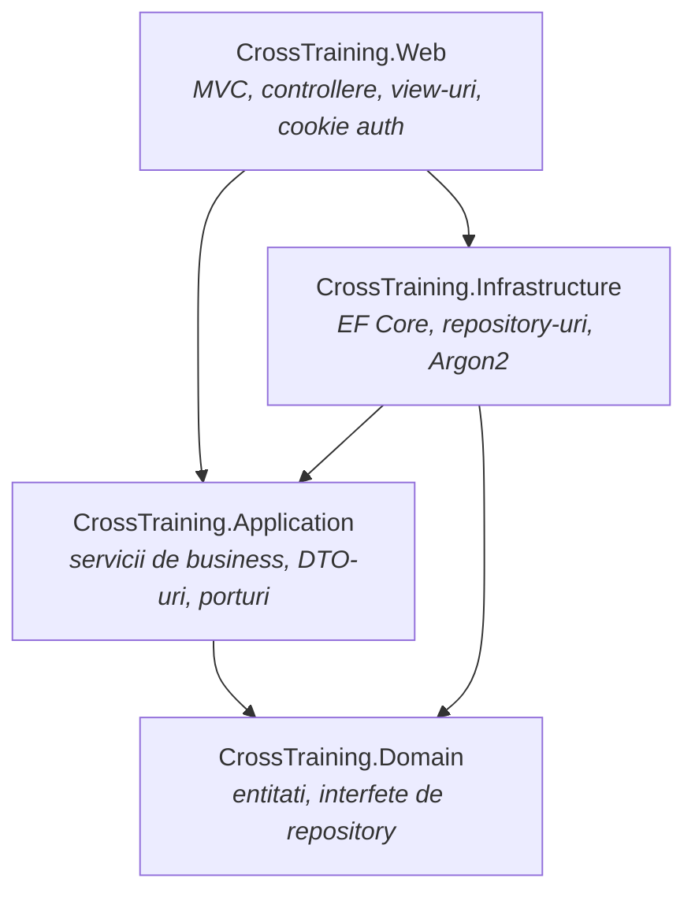

# CrossTrainingPlatform

Platforma web ASP.NET Core (MVC, .NET 8) prin care utilizatorii primesc jocuri
educationale filtrate dupa domeniile pe care si le-au ales, iar administratorii
gestioneaza domeniile, jocurile, rolurile si permisiunile.

---

## Arhitectura

Solutia este impartita pe patru straturi, cu dependintele orientate spre interior:
`Domain` nu stie de nimeni, iar `Web` nu vorbeste niciodata direct cu baza de date.



| Proiect | Rol | Are voie sa refere |
|---|---|---|
| `CrossTraining.Domain` | Strict entitati. Fara interfete, fara dependinte externe. | nimic |
| `CrossTraining.Application` | Cazurile de utilizare, DTO-uri de citire, request-uri, si toate porturile catre exterior (`Abstractions/`). Vezi [ADR-0006](docs/adr/0006-locul-porturilor-si-al-modelelor.md). | `Domain` |
| `CrossTraining.Infrastructure` | EF Core (`AppDbContext`, configurari Fluent API), repository-uri, hashing Argon2id. | `Domain`, `Application` |
| `CrossTraining.Web` | Controllere MVC, view-uri Razor, modele de formular, autentificare pe cookie, compunerea DI. | `Application`, `Infrastructure` |

`Web` refera `Infrastructure` **doar** pentru inregistrarea serviciilor in DI
(`AddInfrastructure`). Controllerele lucreaza exclusiv prin interfetele din `Application`,
primesc modele de formular si afiseaza DTO-uri: nicio entitate de domeniu nu ajunge in
model binding sau intr-un view. Toate aceste reguli sunt verificate de
`tests/CrossTraining.ArchitectureTests`.

### Autentificare si autorizare

Autentificare pe cookie, fara ASP.NET Identity. La login se incarca rolul si drepturile
utilizatorului si se scriu ca `Claim`-uri in cookie:

```
ClaimTypes.NameIdentifier -> UserId
ClaimTypes.Role           -> numele rolului
"permission"              -> cate un claim per drept, derivat din rol
"refreshed_at"            -> cand au fost citite ultima data din baza
```

Autorizarea se face **pe drepturi, nu pe roluri**:

```csharp
[HasPermission(Permissions.Roles.Manage)]
public async Task<IActionResult> Edit(int id, RoleFormModel form) { ... }
```

Politicile se construiesc la cerere din numele dreptului, deci nu exista o lista de
inregistrat manual. Drepturile si acordarea lor catre rolul Admin vin din migrarea
`SeedPermissions` - nu exista nicio scurtatura in cod pentru rolul Admin, tocmai ca sursa
de adevar sa fie baza de date (vezi [ADR-0008](docs/adr/0008-cqrs-si-autorizare-pe-drepturi.md)).

Lista drepturilor sta in `Application/Authorization/Permissions.cs`, langa `SystemRoles`
(`User`, `Admin`). Drepturile si rolurile de aici sunt **de sistem**: nu pot fi redenumite
sau dezactivate din ecranele de administrare, numele lor sunt rezervate, iar rolul Admin
nu poate pierde un drept de sistem. Altfel, un singur click putea lasa aplicatia fara
administrator (vezi [ADR-0009](docs/adr/0009-protectia-drepturilor-si-rolurilor-de-sistem.md)).
Numele drepturilor si al rolurilor sunt unice, iar rolurile si drepturile dezactivate se
pot reactiva din ecran.

Meniul si butoanele din view-uri folosesc `User.HasPermission(...)`, aceeasi regula ca
autorizarea, deci nu afiseaza actiuni pe care utilizatorul nu le poate face.

Identitatea din cookie se **reciteste din baza** la fiecare 5 minute (configurabil prin
`Security:PrincipalRefreshSeconds`). Fara asta, un drept revocat ar ramane valabil pana la
expirarea cookie-ului, iar un cont dezactivat ar continua sa functioneze.

Parolele sunt stocate exclusiv ca hash **Argon2id** in format PHC
(`$argon2id$v=19$m=65536,t=3,p=2$...`), cu salt unic per parola. Parametrii sunt in
`Infrastructure/Security/PasswordService.cs` si pot fi cresctuti in timp fara sa
invalideze hash-urile existente, pentru ca formatul PHC isi poarta parametrii cu el.

### Controale de securitate

| Control | Unde |
|---|---|
| Autorizare implicita: orice endpoint cere cont, exceptiile sunt `[AllowAnonymous]` | `Program.cs` (`FallbackPolicy`) |
| Autorizare pe drepturi, cu politici construite la cerere | `Web/Security/PermissionAuthorization.cs` |
| Reimprospatarea drepturilor din baza la 5 minute | `Web/Security/RefreshUserPrincipal.cs` |
| Drepturi si roluri de sistem protejate, nume unice | `Application/Authorization/`, `Application/Features/Claims`, `Application/Features/Roles` |
| Rate limiting pe login si register: 10 incercari / 5 min per IP | `Program.cs`, `Web/Security/RateLimitPolicies.cs` |
| Cookie: `HttpOnly`, `SameSite=Lax`, `Secure`, nume propriu | `Program.cs` |
| CSP + `X-Content-Type-Options`, `X-Frame-Options`, `Referrer-Policy`, `Permissions-Policy` | `Web/Middleware/SecurityHeadersMiddleware.cs` |
| Id-ul de utilizator semnat in pasul de inregistrare (vezi [ADR-0004](docs/adr/0004-identitate-in-fluxul-de-inregistrare.md)) | `Web/Security/RegistrationTokenProtector.cs` |
| Antiforgery pe toate actiunile POST | atribute pe controllere |

Secretele nu stau in repo. In dezvoltare vin din user-secrets, in rest din variabile de
mediu sau secret store; lipsa lor opreste pornirea aplicatiei cu un mesaj explicit.

### Cazuri de utilizare

Stratul Application nu are servicii: fiecare caz de utilizare este o comanda sau o
interogare, cu handlerul si validatorul in acelasi fisier, sub `Application/Features/`.

```
Features/Roles/RoleUseCases.cs
  SearchRolesQuery      + SearchRolesValidator      + SearchRolesHandler
  CreateRoleCommand     + CreateRoleValidator       + CreateRoleHandler
  ...
```

Trei pipeline behaviors se aplica automat, in aceasta ordine: **logare** (un rand per caz
de utilizare, cu durata), **validare** (FluentValidation; respinge inainte sa se deschida
o tranzactie) si **tranzactie** (doar pentru comenzi - o interogare nu are ce comite).

Controllerele trimit mesaje prin `ISender` si nu ating niciodata un repository; regula e
verificata de un test de arhitectura.

### Model de date

```
AppUser ──┬── RoleId ──> AppRole ──< AppClaim_AppRole >── AppClaim
          │
          └──< UserDomain >── Domain ──< Game
```

`AppUser <-> Domain` si `AppRole <-> AppClaim` sunt relatii many-to-many prin tabele
pivot. `Game` apartine unui singur `Domain`.

---

## Rulare locala

Necesar: **.NET SDK** conform `global.json` si **SQL Server** (Express e suficient).

```bash
# 1. Baza de date - ATENTIE: scriptul face DROP TABLE, doar pentru mediu de dezvoltare.
sqlcmd -S localhost\SQLEXPRESS -i db/002_Recreate_Schema.sql

# 2. Connection string-ul, in afara repo-ului
dotnet user-secrets --project src/CrossTraining.Web set "ConnectionStrings:DefaultConnection" "Server=localhost\SQLEXPRESS;Database=CrossTrainingPlatform;Trusted_Connection=True;TrustServerCertificate=True"

# 3. Rulare
dotnet run --project src/CrossTraining.Web
```

Valoarea din `appsettings.json` este doar un fallback de dezvoltare; in orice alt
mediu connection string-ul vine din variabile de mediu sau dintr-un secret store.

### Baza de date

Schema este descrisa de **migrarile EF Core** (vezi [ADR-0007](docs/adr/0007-migrari-si-soft-delete.md)).
`dotnet-ef` este fixat ca unealta locala, deci nu trebuie instalat global:

```bash
dotnet tool restore
```

**Baza noua, goala** - migrarile creeaza schema:

```bash
dotnet ef database update --project src/CrossTraining.Infrastructure
```

**Baza care exista deja**, de dinaintea migrarilor - se marcheaza o singura data ca fiind
la zi, fara sa se atinga datele:

```bash
sqlcmd -S localhost\SQLEXPRESS -d CrossTrainingPlatform -i db/003_EF_Baseline.sql
```

Comanda de generare a unei migrari noi (factory-ul de design-time nu deschide conexiunea,
deci nu are nevoie de connection string):

```bash
dotnet ef migrations add NumeleMigrarii --project src/CrossTraining.Infrastructure --output-dir Persistence/Migrations
```

CI verifica automat ca modelul si migrarile nu au divergat.

| Script | Ce face |
|---|---|
| `001_Migrate_DomainList_to_UserDomain.sql` | Migreaza vechea coloana JSON `DomainList` in tabelul pivot `UserDomain`. |
| `002_Recreate_Schema.sql` | Recreeaza schema de la zero. **Distructiv** - doar pe medii de dezvoltare. Pastrat pentru ca testele de persistenta il folosesc. |
| `003_EF_Baseline.sql` | Marcheaza o baza existenta ca fiind la nivelul migrarii initiale. |

### Soft-delete

Nimic nu se sterge fizic: cele cinci entitati implementeaza `ISoftDeletable`, iar
`AppDbContext` aplica un filtru global. Randurile dezactivate dispar din orice interogare;
ecranele de administrare cer explicit `IgnoreQueryFilters()`, ca sa le poata reactiva.
Consecinta directa: **un cont dezactivat nu se poate autentifica**.

## Convergenta pe calitate

Regulile sunt aplicate la build, nu lasate la latitudinea fiecaruia:

| Fisier | Ce impune |
|---|---|
| `Directory.Build.props` | `net8.0`, nullable, `TreatWarningsAsErrors`, analizoare la nivel `Recommended`, build determinist. |
| `Directory.Packages.props` | Central Package Management - versiunile NuGet se declara o singura data. |
| `.editorconfig` | Stil de cod si conventii de numire, verificate la build (`EnforceCodeStyleInBuild`). |
| `global.json` | Pineaza versiunea de SDK, ca sa nu difere build-ul local de cel din CI. |
| `.github/workflows/ci.yml` | Restore, build Release, verificare de formatare, teste. |

Verificarea completa, local, inainte de push:

```bash
dotnet build CrossTraining.sln -c Release
dotnet format CrossTraining.sln --verify-no-changes
dotnet test CrossTraining.sln -c Release --no-build
```

Un warning opreste build-ul. Daca o regula de analizor chiar nu isi merita
zgomotul in acest proiect, se dezactiveaza explicit in `.editorconfig`, cu motivul
scris langa ea - nu se suprima punctual prin `#pragma`.

---


## Testare

166 de teste, impartite pe trei proiecte (vezi [ADR-0005](docs/adr/0005-strategia-de-testare.md)):

```bash
dotnet test CrossTraining.sln
```

| Proiect | Ce acopera | Cere SQL Server |
|---|---|---|
| `tests/CrossTraining.UnitTests` | logica de business, cu dependinte inlocuite | nu |
| `tests/CrossTraining.ArchitectureTests` | regula de dependinta dintre straturi (NetArchTest) | nu |
| `tests/CrossTraining.IntegrationTests` | pipeline-ul HTTP real, randarea paginilor de administrare, interogarile de repository | pentru randare si repository |

Testele de persistenta isi creeaza propria baza, `CrossTrainingPlatform_Tests`, si o
recreeaza din `db/002_Recreate_Schema.sql`. Baza de dezvoltare nu este atinsa niciodata.
Connection string-ul vine din `CROSSTRAINING_TEST_SQL`, sau se cade pe
`localhost\SQLEXPRESS`. Fara niciun server accesibil, acele teste se **sar**, nu pica:

```bash
# ca sa rulezi si testele de persistenta pe alta instanta
CROSSTRAINING_TEST_SQL="Server=...;User Id=...;Password=...;TrustServerCertificate=True" dotnet test
```

## Documentatie

- [ROADMAP](docs/ROADMAP.md) - ce mai e de facut si in ce ordine.
- [ADR-uri](docs/adr/) - deciziile de arhitectura si motivele din spatele lor.

## Structura

```
CrossTrainingPlatform/
├── db/                        scripturi SQL numerotate
├── docs/
│   ├── adr/                   architecture decision records
│   └── ROADMAP.md
├── src/
│   ├── CrossTraining.Domain/
│   ├── CrossTraining.Application/
│   ├── CrossTraining.Infrastructure/
│   └── CrossTraining.Web/
├── tests/
│   ├── CrossTraining.UnitTests/
│   ├── CrossTraining.ArchitectureTests/
│   └── CrossTraining.IntegrationTests/
├── Directory.Build.props
├── Directory.Packages.props
└── global.json
```
