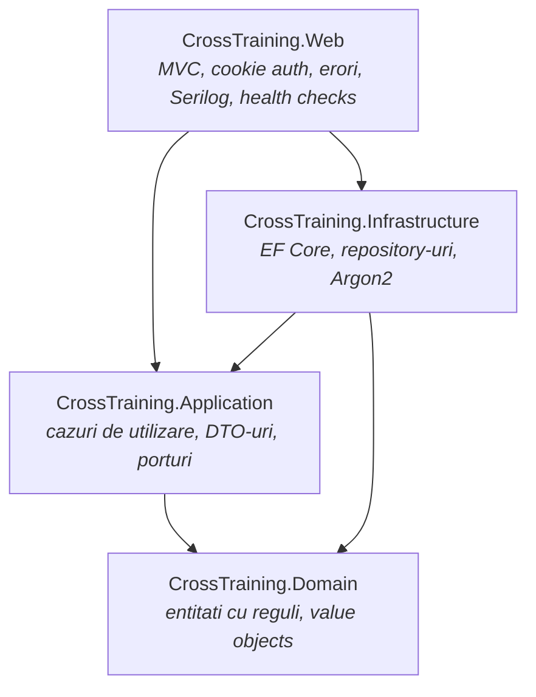

# CrossTrainingPlatform

Platforma web ASP.NET Core (MVC, .NET 10) prin care utilizatorii primesc jocuri
educationale filtrate dupa domeniile pe care si le-au ales, iar administratorii
gestioneaza domeniile, jocurile, rolurile si permisiunile.

---

## Arhitectura

Solutia este impartita pe patru straturi, cu dependintele orientate spre interior:
`Domain` nu stie de nimeni, iar `Web` nu vorbeste niciodata direct cu baza de date.



| Proiect | Rol | Are voie sa refere |
|---|---|---|
| `CrossTraining.Domain` | Entitatile si regulile lor de business (setteri privati, metode care isi verifica regulile), value object-ul `Email`, lista drepturilor si a rolurilor de sistem. Fara interfete, fara pachete. Vezi [ADR-0010](docs/adr/0010-domeniu-bogat-si-o-singura-sursa-pentru-invarianti.md). | nimic |
| `CrossTraining.Application` | Cazurile de utilizare, DTO-uri de citire, request-uri, si toate porturile catre exterior (`Abstractions/`). Vezi [ADR-0006](docs/adr/0006-locul-porturilor-si-al-modelelor.md). | `Domain` |
| `CrossTraining.Infrastructure` | EF Core (`AppDbContext`, configurari Fluent API), repository-uri, hashing Argon2id. | `Domain`, `Application` |
| `CrossTraining.Web` | Controllere MVC, view-uri Razor, modele de formular, autentificare pe cookie, compunerea DI. | `Application`, `Infrastructure` |

`Web` refera `Infrastructure` **doar** pentru inregistrarea serviciilor in DI
(`AddInfrastructure`). Controllerele lucreaza exclusiv prin interfetele din `Application`,
primesc modele de formular si afiseaza DTO-uri: nicio entitate de domeniu nu ajunge in
model binding sau intr-un view. Toate aceste reguli sunt verificate de
`tests/CrossTraining.ArchitectureTests`.

### Autentificare si autorizare

Autentificare pe cookie, fara ASP.NET Identity. La login se incarca rolul si drepturile
utilizatorului si se scriu ca `Claim`-uri in cookie:

```
ClaimTypes.NameIdentifier -> UserId
ClaimTypes.Role           -> numele rolului
"permission"              -> cate un claim per drept, derivat din rol
"refreshed_at"            -> cand au fost citite ultima data din baza
```

Autorizarea se face **pe drepturi, nu pe roluri**:

```csharp
[HasPermission(Permissions.Roles.Manage)]
public async Task<IActionResult> Edit(int id, RoleFormModel form) { ... }
```

Politicile se construiesc la cerere din numele dreptului, deci nu exista o lista de
inregistrat manual. Drepturile si acordarea lor catre rolul Admin vin din migrarea
`SeedPermissions` - nu exista nicio scurtatura in cod pentru rolul Admin, tocmai ca sursa
de adevar sa fie baza de date (vezi [ADR-0008](docs/adr/0008-cqrs-si-autorizare-pe-drepturi.md)).

Lista drepturilor sta in `Domain/Authorization/Permissions.cs`, langa `SystemRoles`
(`User`, `Admin`). Drepturile si rolurile de aici sunt **de sistem**: nu pot fi redenumite
sau dezactivate din ecranele de administrare, numele lor sunt rezervate, iar rolul Admin
nu poate pierde un drept de sistem. Altfel, un singur click putea lasa aplicatia fara
administrator (vezi [ADR-0009](docs/adr/0009-protectia-drepturilor-si-rolurilor-de-sistem.md)).
Numele drepturilor si al rolurilor sunt unice, iar rolurile si drepturile dezactivate se
pot reactiva din ecran.

Meniul si butoanele din view-uri folosesc `User.HasPermission(...)`, aceeasi regula ca
autorizarea, deci nu afiseaza actiuni pe care utilizatorul nu le poate face.

Identitatea din cookie se **reciteste din baza** la fiecare 5 minute (configurabil prin
`Security:PrincipalRefreshSeconds`). Fara asta, un drept revocat ar ramane valabil pana la
expirarea cookie-ului, iar un cont dezactivat ar continua sa functioneze.

Parolele sunt stocate exclusiv ca hash **Argon2id** in format PHC
(`$argon2id$v=19$m=65536,t=3,p=2$...`), cu salt unic per parola. Parametrii sunt in
`Infrastructure/Security/PasswordService.cs` si pot fi cresctuti in timp fara sa
invalideze hash-urile existente, pentru ca formatul PHC isi poarta parametrii cu el.

### Controale de securitate

| Control | Unde |
|---|---|
| Autorizare implicita: orice endpoint cere cont, exceptiile sunt `[AllowAnonymous]` | `Program.cs` (`FallbackPolicy`) |
| Autorizare pe drepturi, cu politici construite la cerere | `Web/Security/PermissionAuthorization.cs` |
| Reimprospatarea drepturilor din baza la 5 minute | `Web/Security/RefreshUserPrincipal.cs` |
| Drepturi si roluri de sistem protejate, nume unice | `Domain/Entities/AppClaim.cs`, `Domain/Entities/AppRole.cs`, index unic in baza |
| Linkurile de joc doar `http`/`https` (fara `javascript:` intr-un `href`) | `Domain/Entities/Game.cs` |
| Erori fara detalii interne catre client; cod de cerere pentru suport | `Web/Middleware/AjaxExceptionHandler.cs`, `/Home/Error` |
| `X-Forwarded-For` acceptat doar de la proxy-uri declarate | `Program.cs` (`ReverseProxy:KnownProxies`) |
| Rate limiting pe login si register: 10 incercari / 5 min per IP | `Program.cs`, `Web/Security/RateLimitPolicies.cs` |
| Cookie: `HttpOnly`, `SameSite=Lax`, `Secure`, nume propriu | `Program.cs` |
| CSP fara `'unsafe-inline'` in `script-src` (view-urile nu au script inline, verificat de teste) + `X-Content-Type-Options`, `X-Frame-Options`, `Referrer-Policy`, `Permissions-Policy` | `Web/Middleware/SecurityHeadersMiddleware.cs` |
| Id-ul de utilizator semnat in pasul de inregistrare (vezi [ADR-0004](docs/adr/0004-identitate-in-fluxul-de-inregistrare.md)) | `Web/Security/RegistrationTokenProtector.cs` |
| Antiforgery pe toate actiunile POST | atribute pe controllere |

Secretele nu stau in repo. Connection string-ul local (autentificare Windows, fara parola)
vine din profilul de lansare; in rest, din variabile de mediu sau dintr-un secret store.
Lipsa lui opreste pornirea aplicatiei cu un mesaj explicit.

### Domeniu

Regulile de business stau in entitati, nu in servicii sau validatoare (vezi
[ADR-0010](docs/adr/0010-domeniu-bogat-si-o-singura-sursa-pentru-invarianti.md)).
Entitatile au setteri privati; starea se schimba doar prin metode care isi verifica
regulile si intorc un `DomainResult` cu motivul refuzului:

```csharp
var result = claim.Deactivate();   // refuzat pentru un drept de sistem
var granted = role.Grant(claim);   // refuzat pentru un drept dezactivat
var created = Game.Create(name, description, link, domainId, createdAt);  // link doar http/https
```

`Email` este value object: validat si normalizat o singura data, la creare. Un test de
arhitectura pica daca o entitate primeste un setter public.

### Cazuri de utilizare

Stratul Application nu are servicii: fiecare caz de utilizare este o comanda sau o
interogare cu handlerul ei, in acelasi fisier, sub `Application/Features/`. Handlerul
incarca datele, cere entitatii sa faca operatia si salveaza; pastreaza doar regulile care
cer acces la date (numele e deja luat? domeniul ales exista?).

```
Features/Roles/RoleUseCases.cs
  SearchRolesQuery      + SearchRolesHandler
  CreateRoleCommand     + CreateRoleHandler
  ...
```

Doua pipeline behaviors se aplica automat: **logare** (un rand per caz de utilizare, cu
durata; refuzurile apar ca refuz, cu motivul) si **tranzactie** (doar pentru comenzi - o
interogare nu are ce comite).

Unde se valideaza ce: formularele din Web pentru ce vede utilizatorul (`[Required]`,
lungimi), entitatile pentru invariantii de business, handlerele pentru regulile care cer
date. Fiecare regula are un singur loc.

Controllerele trimit mesaje prin `ISender` si nu ating niciodata un repository; regula e
verificata de un test de arhitectura.

### Erori, logging, sanatate

Vezi [ADR-0011](docs/adr/0011-erori-logging-si-configurare-pentru-productie.md) si
[ADR-0012](docs/adr/0012-raspunsuri-ajax-si-comportament-declarativ.md).

| Ce | Cum |
|---|---|
| Formular invalid sau refuz de business intr-o cerere din JS | `400` `ProblemDetails` cu `success`, `errors` si codul cererii (`AjaxResponseExtensions`) |
| Inregistrare lipsa ceruta dintr-un modal | `404` `ProblemDetails`, aceeasi forma |
| Eroare neasteptata intr-o cerere din JS | `500` `ProblemDetails`, aceeasi forma (`AjaxExceptionHandler`) |
| Eroare neasteptata intr-o pagina | `/Home/Error`, cu acelasi cod de cerere |
| Logging | Serilog, structurat: text lizibil local, JSON compact in rest; un rand per cerere HTTP |
| `/health` | procesul raspunde (repornire automata) |
| `/health/ready` | aplicatia ajunge la baza de date (trimitere de trafic) |

### Model de date

```
AppUser ──┬── RoleId ──> AppRole ──< AppClaim_AppRole >── AppClaim
          │
          └──< UserDomain >── Domain ──< Game
```

`AppUser <-> Domain` si `AppRole <-> AppClaim` sunt relatii many-to-many prin tabele
pivot. `Game` apartine unui singur `Domain`.

### Interfata

Tema intunecata, „futurista”: fundal cu aurora si grila, panouri de sticla, degrade
cyan-violet. Interfata este in romana.

| Ce | Unde |
|---|---|
| Tema: culori, tipografie, componente (butoane, formulare, tabele, modale, carduri) | `wwwroot/css/app.css` - o singura foaie de stil, peste Bootstrap 5.1 |
| Modale, formulare AJAX, mesaje (toasts) | `wwwroot/js/admin.js`, legat prin atribute `data-*` (ADR-0012) |
| Catalogul: cautare instantanee, filtre pe domeniu si „recomandate” | `wwwroot/js/games.js` |
| Initialele si culoarea fiecarei aplicatii | `Web/Extensions/DisplayExtensions.cs` |
| Fonturi | ale sistemului (Bahnschrift, Segoe UI): CSP-ul nu permite fonturi de pe alte domenii |

---

## Rulare locala

Necesar: **.NET SDK** conform `global.json` si **SQL Server** (Express e suficient).

```bash
# 1. Baza de date: migrarile creeaza schema (vezi "Baza de date" mai jos).
dotnet tool restore
dotnet ef database update --project src/CrossTraining.Infrastructure --connection "Server=localhost\SQLEXPRESS;Database=CrossTrainingPlatform;Trusted_Connection=True;TrustServerCertificate=True"

# 2. Rulare - profilul CrossTraining.Web aduce mediul Development si connection string-ul.
#    Din Visual Studio: F5, cu CrossTraining.Web selectat langa butonul de Run.
dotnet run --project src/CrossTraining.Web
```

Pentru rularea locala, connection string-ul vine din profilul `CrossTraining.Web` din
`launchSettings.json`, ca variabila de mediu `ConnectionStrings__DefaultConnection`.
Foloseste autentificarea Windows, deci nu contine nicio parola. Variabilele de mediu au
prioritate fata de user-secrets: pentru alt server SQL, se schimba valoarea din profil.

De ce in profil si nu doar in user-secrets: pornita din Visual Studio 2026, aplicatia nu
primea connection string-ul din user-secrets, desi mediul era Development si fisierul de
secrete era corect. Acelasi executabil, cu aceleasi variabile de mediu, pornea normal
din afara debugger-ului; cauza exacta din Visual Studio nu a fost gasita. Variabilele
din profil ajung sigur la proces.

Profilul IIS Express a fost scos din acelasi motiv. In afara dezvoltarii locale,
connection string-ul vine din variabila `ConnectionStrings__DefaultConnection` sau
dintr-un secret store - niciodata dintr-un fisier versionat cu parola in el.

### Configurare pentru productie

Totul se seteaza prin variabile de mediu (vezi [ADR-0011](docs/adr/0011-erori-logging-si-configurare-pentru-productie.md)):

| Variabila | Rol | Obligatorie |
|---|---|---|
| `ASPNETCORE_ENVIRONMENT=Production` | activeaza pagina de eroare, HSTS si logurile JSON | da |
| `ConnectionStrings__DefaultConnection` | baza de date, cu un utilizator SQL dedicat (doar citire/scriere pe tabele) | da |
| `DataProtection__KeysPath` | folder comun si persistent pentru cheile care semneaza cookie-urile; fara el, o repornire intr-un container delogheaza pe toata lumea | da, in container sau pe mai multe instante |
| `ReverseProxy__KnownProxies__0` | IP-ul reverse proxy-ului de incredere, ca rate limiting-ul sa vada adresa reala a clientului | da, in spatele unui proxy |

Migrarile se aplica inainte de pornirea noii versiuni, cu `dotnet ef database update`
(sau cu un script generat de `dotnet ef migrations script --idempotent`). Orchestratorul
foloseste `/health` pentru repornire si `/health/ready` pentru trimiterea de trafic.

### Baza de date

Schema este descrisa de **migrarile EF Core** (vezi [ADR-0007](docs/adr/0007-migrari-si-soft-delete.md)).
`dotnet-ef` este fixat ca unealta locala, deci nu trebuie instalat global:

```bash
dotnet tool restore
```

**Baza noua, goala** - migrarile creeaza schema. Factory-ul de design-time nu citeste
user-secrets, deci connection string-ul se da explicit (sau prin variabila
`CROSSTRAINING_MIGRATIONS_SQL`); fara el, comanda incearca `(localdb)\design-time`:

```bash
dotnet ef database update --project src/CrossTraining.Infrastructure --connection "Server=localhost\SQLEXPRESS;Database=CrossTrainingPlatform;Trusted_Connection=True;TrustServerCertificate=True"
```

**Baza care exista deja**, de dinaintea migrarilor - se marcheaza o singura data ca fiind
la zi, fara sa se atinga datele:

```bash
sqlcmd -S localhost\SQLEXPRESS -d CrossTrainingPlatform -i db/003_EF_Baseline.sql
```

Comanda de generare a unei migrari noi (factory-ul de design-time nu deschide conexiunea,
deci nu are nevoie de connection string):

```bash
dotnet ef migrations add NumeleMigrarii --project src/CrossTraining.Infrastructure --output-dir Persistence/Migrations
```

CI verifica automat ca modelul si migrarile nu au divergat.

| Script | Ce face |
|---|---|
| `001_Migrate_DomainList_to_UserDomain.sql` | Migreaza vechea coloana JSON `DomainList` in tabelul pivot `UserDomain`. |
| `002_Recreate_Schema.sql` | Recreeaza schema de la zero. **Distructiv** - doar pe medii de dezvoltare. Pastrat pentru ca testele de persistenta il folosesc. |
| `003_EF_Baseline.sql` | Marcheaza o baza existenta ca fiind la nivelul migrarii initiale. |

### Soft-delete

Nimic nu se sterge fizic: cele cinci entitati implementeaza `ISoftDeletable`, iar
`AppDbContext` aplica un filtru global. Randurile dezactivate dispar din orice interogare;
ecranele de administrare cer explicit `IgnoreQueryFilters()`, ca sa le poata reactiva.
Consecinta directa: **un cont dezactivat nu se poate autentifica**.

## Convergenta pe calitate

Regulile sunt aplicate la build, nu lasate la latitudinea fiecaruia:

| Fisier | Ce impune |
|---|---|
| `Directory.Build.props` | `net10.0`, nullable, `TreatWarningsAsErrors`, analizoare la nivel `Recommended`, build determinist. |
| `Directory.Packages.props` | Central Package Management - versiunile NuGet se declara o singura data. |
| `.editorconfig` | Stil de cod si conventii de numire, verificate la build (`EnforceCodeStyleInBuild`). |
| `global.json` | Pineaza versiunea de SDK, ca sa nu difere build-ul local de cel din CI. |
| `.github/workflows/ci.yml` | Restore, build Release, verificare de formatare, teste. |

Verificarea completa, local, inainte de push:

```bash
dotnet build CrossTraining.sln -c Release
dotnet format CrossTraining.sln --verify-no-changes
dotnet test CrossTraining.sln -c Release --no-build
```

Un warning opreste build-ul. Daca o regula de analizor chiar nu isi merita
zgomotul in acest proiect, se dezactiveaza explicit in `.editorconfig`, cu motivul
scris langa ea - nu se suprima punctual prin `#pragma`.

---


## Testare

222 de teste, impartite pe trei proiecte (vezi [ADR-0005](docs/adr/0005-strategia-de-testare.md)):

```bash
dotnet test CrossTraining.sln
```

| Proiect | Ce acopera | Cere SQL Server |
|---|---|---|
| `tests/CrossTraining.UnitTests` (133) | regulile entitatilor, direct, fara mock-uri (`Domain/`); cazurile de utilizare, cu dependinte inlocuite (`Features/`) | nu |
| `tests/CrossTraining.ArchitectureTests` (14) | regula de dependinta dintre straturi si incapsularea entitatilor (NetArchTest) | nu |
| `tests/CrossTraining.IntegrationTests` (75) | pipeline-ul HTTP real, randarea paginilor de administrare, erorile si verificarile de sanatate, interogarile de repository | pentru randare si repository |

Testele de persistenta isi creeaza propria baza, `CrossTrainingPlatform_Tests`, si o
recreeaza din migrari. Baza de dezvoltare nu este atinsa niciodata.
Connection string-ul vine din `CROSSTRAINING_TEST_SQL`, sau se cade pe
`localhost\SQLEXPRESS`. Fara niciun server accesibil, acele teste se **sar**, nu pica:

```bash
# ca sa rulezi si testele de persistenta pe alta instanta
CROSSTRAINING_TEST_SQL="Server=...;User Id=...;Password=...;TrustServerCertificate=True" dotnet test
```

## Documentatie

- [ROADMAP](docs/ROADMAP.md) - ce mai e de facut si in ce ordine.
- [ADR-uri](docs/adr/) - deciziile de arhitectura si motivele din spatele lor.

## Structura

```
CrossTrainingPlatform/
├── db/                        scripturi SQL numerotate
├── docs/
│   ├── adr/                   architecture decision records
│   └── ROADMAP.md
├── src/
│   ├── CrossTraining.Domain/
│   ├── CrossTraining.Application/
│   ├── CrossTraining.Infrastructure/
│   └── CrossTraining.Web/
├── tests/
│   ├── CrossTraining.UnitTests/
│   ├── CrossTraining.ArchitectureTests/
│   └── CrossTraining.IntegrationTests/
├── Directory.Build.props
├── Directory.Packages.props
└── global.json
```
